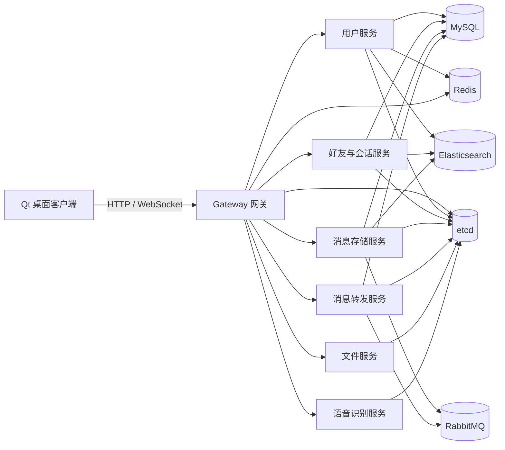

# ChatSystem

一个使用 C++ 实现的分布式即时通信系统。项目包含 Qt 桌面客户端、WebSocket/HTTP 网关以及按业务拆分的后端微服务，可用于学习即时通信、服务发现、RPC、消息队列和数据持久化等技术。


## 功能特性

- 用户名注册与登录
- 手机号注册、登录和短信验证码
- 用户资料、头像、昵称、签名和手机号管理
- 好友搜索、好友申请、申请处理和好友删除
- 单聊与多人会话
- 文本、图片、文件和语音消息
- 历史消息、最近消息和消息搜索
- WebSocket 实时消息通知
- 客户端消息 ID 与服务端幂等持久化，避免重试导致重复消息
- 消息发送状态（发送中、已发送、已送达、失败）与本地消息去重
- 文件存储与语音识别
- 基于 etcd 的服务注册与发现

## 系统架构



## 服务说明

| 服务 | 默认端口 | 职责 |
| --- | ---: | --- |
| Gateway | 9000 / 9001 | HTTP API、WebSocket 长连接和请求转发 |
| Speech | 10001 | 语音识别 |
| File | 10002 | 文件上传与下载 |
| User | 10003 | 注册、登录和用户资料 |
| Transmit | 10004 | 消息投递与转发 |
| Message | 10005 | 消息持久化、历史记录和搜索 |
| Friend | 10006 | 好友关系和聊天会话 |
| etcd | 2379 | 服务注册与发现 |
| MySQL | 3306 | 关系数据存储 |
| RabbitMQ | 5672 | 异步消息传递 |
| Redis | 6379 | 登录状态、会话和验证码缓存 |
| Elasticsearch | 9200 / 9300 | 用户与消息检索 |

## 技术栈

### 客户端

- C++17
- Qt 6 Widgets
- Qt Network、WebSockets、Protobuf、Multimedia
- CMake

### 服务端

- C++ / CMake
- brpc + Protobuf
- WebSocket++
- etcd-cpp-apiv3
- MySQL + ODB
- Redis / redis-plus-plus
- RabbitMQ
- Elasticsearch
- gflags、spdlog、fmt
- Docker Compose

## 目录结构

```text
ChatSystem/
├── client/
│   ├── ChatClient/          # Qt 桌面聊天客户端
│   └── ChatServerMock/      # 客户端联调使用的模拟服务端
└── server/
    ├── common/              # 日志、RPC、数据库、缓存等公共组件
    ├── conf/                # 各服务的 gflags 配置
    ├── file/                # 文件服务
    ├── friend/              # 好友与会话服务
    ├── gateway/             # HTTP / WebSocket 网关
    ├── message/             # 消息存储服务
    ├── odb/                 # ODB 数据模型
    ├── proto/               # Protobuf 接口定义
    ├── speech/              # 语音识别服务
    ├── sql/                 # MySQL 初始化脚本
    ├── transmite/           # 消息转发服务
    ├── user/                # 用户服务
    └── docker-compose.yml   # 基础设施及后端服务编排
```

## 环境要求

推荐在 Ubuntu 22.04 或兼容的 Linux 环境中构建服务端，并提前安装：

- GCC/G++、CMake、Make
- Protobuf 编译器与开发库
- brpc、gflags、spdlog、fmt
- OpenSSL、LevelDB、JsonCpp、Boost、libcurl
- ODB 及 MySQL 运行库
- etcd-cpp-apiv3、hiredis、redis-plus-plus
- RabbitMQ C/C++ 客户端库
- 阿里云 C++ SDK（短信服务）
- Docker 与 Docker Compose

客户端建议使用带有以下模块的 Qt 6：

- Widgets
- Network
- WebSockets
- Protobuf
- Multimedia

## 构建服务端

进入服务端目录后，分别构建各个微服务：

```bash
cd server

for service in file friend gateway message speech transmite user; do
  cmake -S "$service" -B "$service/build"
  cmake --build "$service/build" -j
done
```

收集容器运行所需的动态库和 `nc`：

```bash
bash depends.sh
```

## 配置

服务配置位于 `server/conf/`。运行前至少需要完成以下调整：

1. 将配置文件和 `docker-compose.yml` 中的 `10.0.0.235` 替换为实际可访问的主机地址。
2. 在部署环境中为用户服务提供阿里云短信密钥：

   ```text
   -dms_key_id=YOUR_ACCESS_KEY_ID
   -dms_key_secret=YOUR_ACCESS_KEY_SECRET
   ```

3. 在部署环境中为语音服务配置平台的 `app_id`、`api_key` 和 `secret_key`。
4. 根据实际环境修改 MySQL、RabbitMQ 等中间件的默认账号和密码。

> 不要把真实密钥、令牌或生产密码提交到 Git。推荐使用环境变量、Docker Secrets 或独立的私有配置文件注入敏感信息。

已有数据库升级到新版时，需要执行一次迁移脚本：

```bash
mysql -u root -p < server/sql/migrations/001_password_hash.sql
mysql -u root -p < server/sql/migrations/002_message_idempotency.sql
```

新建数据库直接使用 `server/sql/` 下的初始化脚本即可。历史明文密码会在用户下一次成功登录时自动升级为 PBKDF2-SHA256 哈希。

## 使用 Docker Compose 启动

完成服务端构建和配置后：

```bash
cd server
docker compose up -d --build
```

查看服务状态：

```bash
docker compose ps
```

查看日志：

```bash
docker compose logs -f
```

停止服务：

```bash
docker compose down
```

## 构建客户端

```bash
cmake -S client/ChatClient -B client/ChatClient/build
cmake --build client/ChatClient/build --config Release
```

客户端默认连接 `http://127.0.0.1:9000` 和 `ws://127.0.0.1:9001`，与 Compose 暴露端口一致。
远程部署时在启动前设置环境变量，无需修改源码或重新编译。例如 PowerShell：

```powershell
$env:SOARIM_HTTP_URL = "http://<gateway-host>:9000"
$env:SOARIM_WEBSOCKET_URL = "ws://<gateway-host>:9001"
.\ChatClient.exe
```

默认直连网关；确需使用系统代理时设置 `SOARIM_USE_SYSTEM_PROXY=1`。
连接中断时按 1–30 秒退避重连，收到网关认证成功后才启用消息编辑区；会话失效时清理本地令牌并提示重新登录。

## 运行可靠性与升级说明

### 音频设备

语音使用 16 kHz、单声道、Int16 PCM。录制和播放设备独立初始化；无设备、格式不支持、文件不可写或音频启动失败时提示错误，不发送空录音，也不访问未初始化的设备对象。未做采样率转换，不支持该格式的设备需要更换或配置后重试。

### 登录会话

Redis 原子创建登录会话与租约：未建立长连接的登录占用 30 秒，在线租约 90 秒，会话令牌 24 小时；收到 WebSocket pong 后续租，每 30 秒 ping，10 秒无 pong 则关闭连接。断线释放当前连接所属的租约，未过期令牌可重连；再次密码登录会使旧令牌失效。旧连接关闭不能删除新连接的状态。

首次升级需同时更新 UserService 和 Gateway，旧版本无归属记录的令牌需要重新登录。历史空值登录标记由下一次成功登录替换为有过期时间的租约，不执行批量清库。

### Elasticsearch 索引

启动时使用 `PUT /<index>` 创建真正的 mapping，不再写入 `default_index_id` 文档；初始化失败会阻止 UserService/MessageService 启动。`keyword`/`long` 不设置 analyzer，非检索字段使用 `index: false`。

- 默认文本分词器为 ES 内置 `standard`，无需 IK 插件；如需 IK，在所有 ES 节点安装匹配版本的插件后，为 UserService、MessageService 设置 `SOARIM_ES_TEXT_ANALYZER=ik_max_word`。这不是自动插件安装或索引迁移。
- 已存在的兼容 mapping 直接复用；旧动态 `text + keyword` 字段通过 `.keyword` 子字段查询，不覆盖已有索引。
- mapping 不兼容时先备份，再创建新 mapping、执行 `_reindex`、校验文档数和搜索结果；通过 `SOARIM_ES_USER_INDEX` / `SOARIM_ES_MESSAGE_INDEX` 指定新索引后协调停写切换。迁移时排除历史 `default_index_id` 伪文档。保留旧索引用于回退，不直接删除线上数据。
- `standard` 与 IK 的中文分词行为不同；只有配置并验证 IK 后才能声称使用 IK 中文分词。

### 消息送达语义

HTTP `NewMessageRsp` 成功仅返回 `SENT`、`delivered_target_count=0`，不表示已落库或接收端已确认。接收端将实时消息放入本地缓存后，发送 `ClientAuthenticationReq.delivery_ack`；Gateway 根据已认证连接的用户身份及本次在线投递目标校验 ACK，再通过 `MESSAGE_DELIVERY_NOTIFY` 通知发送者，客户端更新为 `DELIVERED`。历史拉取、发送方自己的推送及 socket 写入不视为送达；重复推送仍 ACK，但不重复显示或增加未读数。

群聊计数为唯一已确认接收者数，至少一位确认即显示“已送达”，不代表全员已读。回执窗口为当前 Gateway 内存中最多 10,000 条、保留 10 分钟；超时、重启、发送方离线造成的回执丢失不会补发，不提供跨网关路由或持久化送达保证。网关与 Qt 客户端需配套升级，旧客户端不发送 ACK 时保持 `SENT`。迟到的 HTTP 回调及历史拉取不会回退已确认的状态。

回归测试命令与范围见 [运行可靠性测试](server/tests/RUNTIME_TESTS.md)。

## 接口定义

服务端 Protobuf 接口位于 `server/proto/`，主要包括：

- `user.proto`：注册、登录和用户信息
- `friend.proto`：好友关系和聊天会话
- `message.proto`：消息存储、历史消息和搜索
- `transmite.proto`：消息转发
- `file.proto`：文件上传与下载
- `speech.proto`：语音识别
- `notify.proto`：实时通知
- `gateway.proto`：网关路由说明

## 消息消费确认与回归测试

MessageService 的 MQ 回调明确返回处理结果：持久化完成或幂等记录已存在时才确认消费；
ES、文件服务或 MySQL 临时失败时，消息保持未确认，一秒后请求 RabbitMQ 重投。
消费者预取数为 1，等待期间不会持续抢取新消息或立即循环重投；依赖恢复后继续处理。
回调异常同样按临时失败处理。

无法解析、缺少消息标识或消息类型与内容不匹配的消息会被拒绝且不重新入队。
如果需要保留这类异常消息，请在 RabbitMQ 为业务队列配置死信交换机（DLX）和对应队列；
未配置 DLX 时，RabbitMQ 会丢弃被拒绝的消息。此改动不修改已有队列的声明参数。

这只修复消费端的确认时机，不提供发布确认、broker 重启持久性或跨 MySQL/ES/文件服务的事务保证。
例如文件上传成功但数据库失败时，重试仍可能产生多余文件，需要独立处理文件幂等或清理策略。

独立构建的持久化单元测试及真实 RabbitMQ 回归测试见 [测试说明](server/tests/README.md)。

## 安全说明

- 用户名密码使用随机盐和 PBKDF2-SHA256 存储，日志不记录密码、验证码、手机号或登录会话令牌。
- 仓库中的默认中间件密码仅适用于本地开发，请勿直接用于公网环境。
- 曾经提交或公开过的云平台密钥应立即吊销并重新创建，仅从 Git 历史中删除并不能保证密钥安全。
- 生产环境应启用 HTTPS/WSS、访问鉴权、限流和审计日志。

## 参与开发

欢迎通过 Issue 提交问题或建议，也欢迎提交 Pull Request 完善功能、文档和测试。

分支开发、提交说明、构建验证与 PR 流程见 [贡献指南](CONTRIBUTING.md)。
